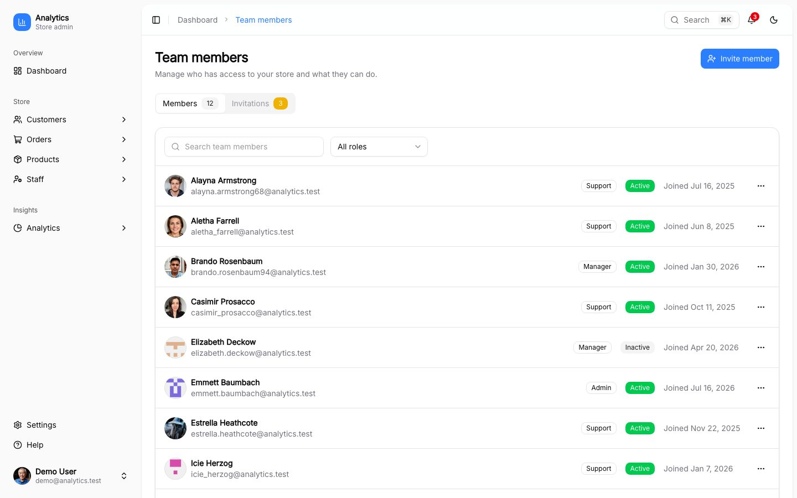
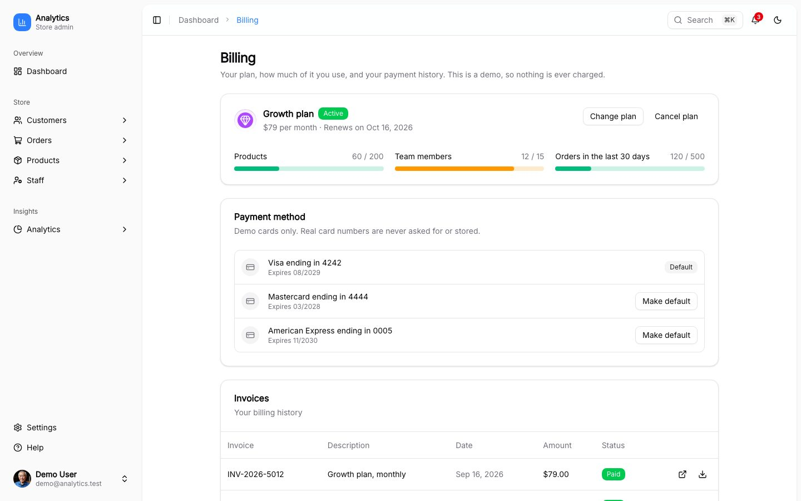

# Analytics UI

[](https://github.com/BayBreezy/analytics-ui/actions/workflows/ci.yml)
[](https://analytics-ui.behonbaker.com)

An ecommerce admin dashboard built with **Nuxt 4, UI Thing, Tailwind CSS v4 and TypeScript**. The UI and a typed mock API live in one repo and run on generated data, so there is nothing to set up.

**[Try the live demo](https://analytics-ui.behonbaker.com)**: on the sign-in page, click **Fill demo credentials** to enter as an admin.


> **Coming from the YouTube tutorial?** The app from the [July 2023 video](https://www.youtube.com/watch?v=0ZwaOAlRAWA) is still here: [open the original version](https://github.com/BayBreezy/analytics-ui/tree/tutorial-2023) (the `tutorial-2023` branch). This repository is a ground-up rebuild of it.

## What it shows

- **A real product surface:** dashboard and analytics, customers, orders, products and staff with search, filters, CSV export and bulk actions, a team page with invitations, billing, settings and help. [See all features](docs/features.md)
- **Roles that are enforced:** admin, manager and support see different pages and can do different things, in the navigation, the route guards and the API (401 and 403). [Roles](docs/roles.md)
- **Full-stack in one repo:** forms and API share the same zod schemas, and a mock REST API serves seeded data from memory. [Architecture](docs/architecture.md) · [API](docs/api.md)
- **Built to be maintained:** strict TypeScript, almost 400 unit, API and browser tests, GitHub Actions CI, lint and format hooks, conventional commits. [Testing](docs/testing.md)
- **Polished details:** a command palette (`Ctrl/Cmd + K`), a notification bell, light and dark mode, loading, empty and error states, and layouts that work down to a phone.

> **A demo, not a product.** Sign-in is simulated, nothing is charged and no email is sent. Data lives in server memory and resets when the server restarts.

## Try it

```bash
bun install
bun run dev
```

Open `http://localhost:3000` and click **Fill demo credentials** (`demo@analytics.test`, an admin). To see what the other roles can do, sign in with any team member's email from the Staff list (any password of 8 or more characters). More in [Roles](docs/roles.md).

| Script          | What it does                                             |
| --------------- | -------------------------------------------------------- |
| `bun run dev`   | Start the dev server                                     |
| `bun run build` | Build for production                                     |
| `bun run test`  | Unit, API and browser tests ([details](docs/testing.md)) |
| `bun run lint`  | Lint with oxlint (`format:check` and `typecheck` too)    |

### Configuration

| Variable                      | Default          | What it does                                                                                |
| ----------------------------- | ---------------- | ------------------------------------------------------------------------------------------- |
| `NUXT_PUBLIC_IDLE_TIMEOUT_MS` | `300000` (5 min) | Default inactivity time before a user is signed out. Each browser can change it in Settings |

## A look around

| Dark mode                                                      | Bulk actions                                                        |
| -------------------------------------------------------------- | ------------------------------------------------------------------- |
|  |  |
| **Analytics**                                                  | **Command palette**                                                 |
|                  |             |
| **Team and invitations**                                       | **Billing**                                                         |
|                      |                             |


## Learn more

[Features](docs/features.md) · [Roles](docs/roles.md) · [Architecture](docs/architecture.md) · [Mock API](docs/api.md) · [Testing and CI](docs/testing.md) · [Contributing](docs/architecture.md#contributing) · [Original tutorial version](https://github.com/BayBreezy/analytics-ui/tree/tutorial-2023)
