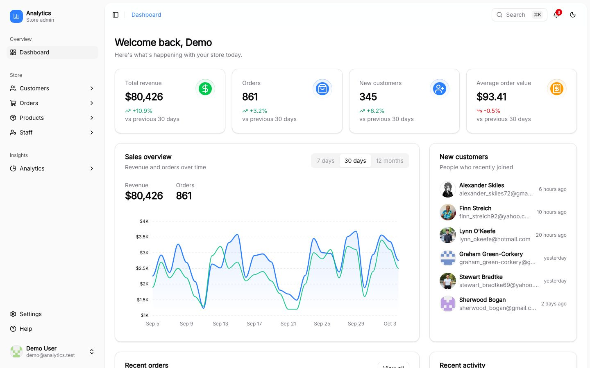
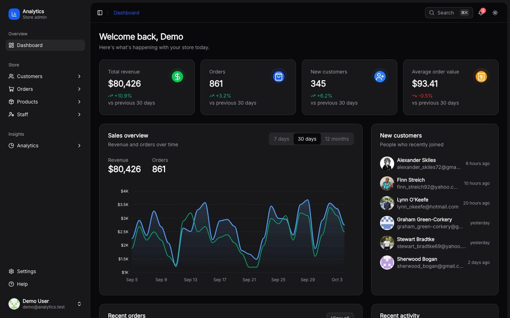
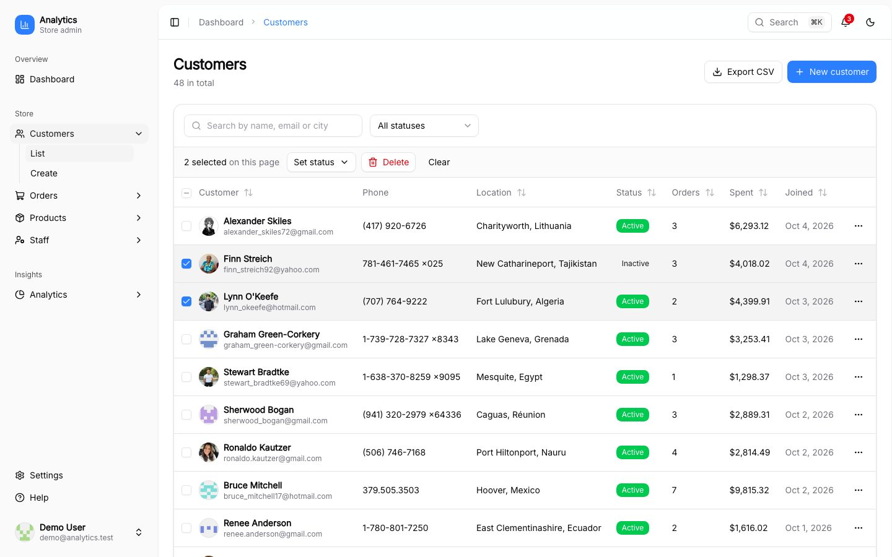
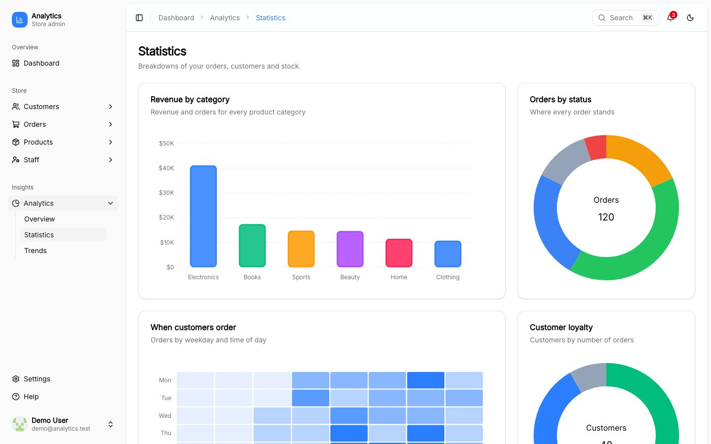
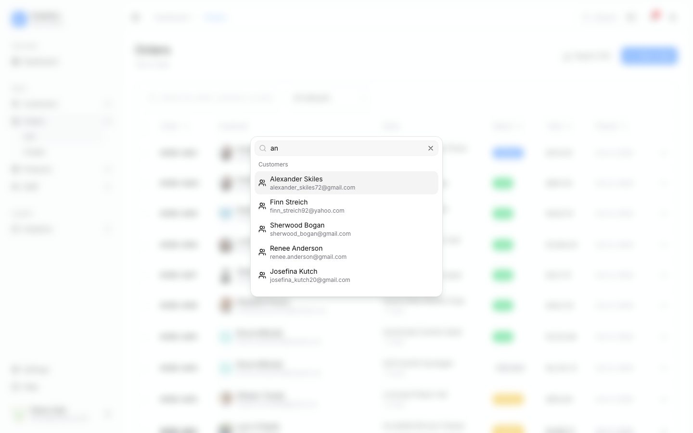
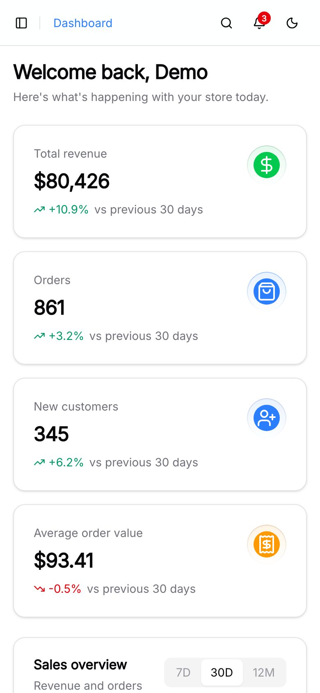

# Analytics UI

[](https://github.com/BayBreezy/analytics-ui/actions/workflows/ci.yml)

An ecommerce admin dashboard built with [Nuxt 4](https://nuxt.com), [UI Thing](https://uithing.com) and [Tailwind CSS v4](https://tailwindcss.com). It runs entirely on mock data: the API lives in Nuxt's `server/` directory and generates its data with [faker](https://fakerjs.dev), so there is nothing to set up but `bun install`.

> **A demo, not a product.** Sign-in is simulated (there are no real passwords and the session cookie isn't signed), nothing is charged and no email is sent. Everything you change is kept in server memory and resets when the server restarts.



**What's in it**

- A dashboard with metric cards, a sales chart, recent orders, customers, activity and reminders
- Customers, orders, products and staff, each with search, sorting, filters, create, edit, delete, CSV export and bulk actions
- Analytics (overview, statistics, trends), a team page with invitations, billing, settings, help and a profile
- Three roles (admin, manager, support) that are enforced in the navigation, the pages and the API
- A command palette (`Ctrl/Cmd + K`), keyboard shortcuts, a notification bell, light and dark mode and layouts that work down to a phone
- Almost 400 tests: unit, API and browser, run by GitHub Actions on every push and pull request

| Dark mode                                                      | Bulk actions                                                        |
| -------------------------------------------------------------- | ------------------------------------------------------------------- |
|  |  |
| **Analytics**                                                  | **Command palette**                                                 |
|                  |             |



This is a rebuild of the app from the July 2023 [YouTube tutorial](https://www.youtube.com/watch?v=0ZwaOAlRAWA). The original version is preserved on the [`tutorial-2023`](https://github.com/BayBreezy/analytics-ui/tree/tutorial-2023) branch.

## Contents

[Getting started](#getting-started) · [Features](#features) · [Tech stack](#tech-stack) · [Testing](#testing) · [Project structure](#project-structure) · [Contributing](#contributing)

## Getting started

```bash
bun install
bun run dev
```

The app runs at `http://localhost:3000`. Sign in with the demo account (`demo@analytics.test`, any password of 8 or more characters), or click **Fill demo credentials** on the login page. See [Roles](#roles) to sign in as a manager or a support agent.

### Scripts

| Script                | What it does                                    |
| --------------------- | ----------------------------------------------- |
| `bun run dev`         | Start the dev server                            |
| `bun run build`       | Build for production                            |
| `bun run preview`     | Preview the production build                    |
| `bun run lint`        | Lint with oxlint (`lint:fix` to fix)            |
| `bun run format`      | Format with oxfmt (`format:check` to verify)    |
| `bun run typecheck`   | Type-check the app, server, Vue files and tests |
| `bun run test`        | Run all the tests (see [Testing](#testing))     |
| `bun run screenshots` | Retake the pictures in `docs/screenshots`       |

### Configuration

| Variable                      | Default          | Description                                                                                 |
| ----------------------------- | ---------------- | ------------------------------------------------------------------------------------------- |
| `NUXT_PUBLIC_IDLE_TIMEOUT_MS` | `300000` (5 min) | Default inactivity time before a user is signed out. Each browser can change it in Settings |

## Features

### Authentication

Sign-in is a demo. There are no real passwords, the session cookie is not signed, and no email is sent. It's meant to exercise the UI and the app's routing, not to be secure.

- **Login, register and forgot-password pages**, with inline validation (zod + vee-validate), loading states, error alerts and toast notifications.
- **Password fields** have a show/hide toggle. The register form also shows a live strength meter and requirements list.
- **"Fill demo" buttons** on the login and register pages fill the form with demo data, so you can try the app in one click.
- **Remember me.** When checked, you stay signed in for 30 days. Otherwise the session ends when the browser closes.
- **Protected routes.** A global route middleware sends signed-out users to `/login`. It runs on the server too, so protected content never flashes.
- **Returns you where you were.** After signing in you land on the last page you visited (falling back to `/dashboard`). Signed-in users who open `/login`, `/register` or `/forgot-password` are redirected away from them. Unknown URLs (for example `/sw.js` requested by a browser extension) are never remembered as a destination.
- **Automatic sign-out when idle.** After 5 minutes without mouse, keyboard, scroll or touch activity you are signed out and shown a toast. Activity in any open tab counts, so using one tab won't sign you out of another. The timeout is configurable: pick 1, 5, 15 or 30 minutes (or never) under **Settings → Security**, and the app default is set with an environment variable (see [Configuration](#configuration)).

**Demo account:** `demo@analytics.test` / `password123`, an admin. Any other well-formed email and a password of 8+ characters will also sign you in as an admin, unless the email belongs to a team member (see [Roles](#roles)).

### Admin layout

- **Collapsible sidebar** built with UI Thing's Sidebar. It collapses to an icon rail (with tooltips), remembers its state in a cookie, toggles with `Ctrl/Cmd + B`, and opens as a slide-over sheet on mobile.
- **Store navigation:** Dashboard, Customers, Orders, Products, Staff, Analytics, Settings and Help, with expandable sub-menus (List and Create), active-page highlighting and breadcrumbs in the header.
- **User menu** in the sidebar footer, with your role, Profile, Billing, Team members and Log out (only the pages your role may open are listed).
- **Notification bell** in the header with an unread count. New orders, new customers, products dropping below 20 in stock and accepted invitations add a notification, and you can open it, or mark everything as read. It looks again every 30 seconds, when the window is focused and when you change page. Read state is shared by everyone in this demo.
- **Command palette:** press `Ctrl/Cmd + K` (or `/`, or use the Search button in the header) to jump to any page you may open, start a New customer, order or product, switch between light and dark mode, log out, or search customers, orders, products and team members by name, email, order number or SKU. Arrow keys and Enter pick a result.
- **Keyboard shortcuts:** `G` then `D`, `O`, `C`, `P` or `S` jumps to the dashboard, orders, customers, products or staff, and `?` opens the shortcut list. They are ignored while you type in a field or when a dialog is open.
- Unknown URLs (such as `/sw.js`) get a friendly 404 page, with a real 404 status. Any other error gets an error page too, and a page that fails while rendering shows a retry inside the layout, so the sidebar keeps working.

### Dashboard

An ecommerce overview at `/dashboard`, with loading skeletons and a retry button if a widget fails to load:

- **Metric cards:** total revenue, orders, new customers and average order value, each with the change versus the previous period.
- **Sales overview:** an ApexCharts revenue and orders chart with a 7 days / 30 days / 12 months switcher. It follows the light and dark theme.
- **Recent orders** in a TanStack Table, with customer, product, status badge, amount and time.
- **New customers**, **recent activity** (orders, sign-ups, reviews, refunds, low stock) and **recently added products** with stock status.
- **Reminders** you can check off, add and delete. They are saved in server memory, and a failed save puts the change back.

### Customers, orders, products and staff

Each of the four has the same set of pages, opened from the sidebar:

- **List** with search, sortable columns, filters, pagination and a row menu (View, Edit, Delete). The search, sort, filters and page live in the URL, so you can reload, go back or share the link and get the same view.
- **Create** and **Edit** forms with inline validation (zod + vee-validate). Details (`/customers/<id>`) and edit (`/customers/<id>/edit`) pages are opened from the list rows.
- **Details** pages: a customer's profile and recent orders, an order's items, totals and customer, a product's price and stock, a team member's profile.
- **Delete** asks for confirmation, from the list and from the details page.
- **Export CSV** downloads everything that matches the search and filters on screen (not just the current page), in the current sort order. Spreadsheet formulas in cell values are defused.
- **Bulk actions:** tick rows (or the header checkbox for the whole page) to set their status or delete them together. A bar shows how many are selected. If some can't be changed, for example the last admin, the rest still go through and the message says why. Selection is per page and clears when the page, search or filters change.
- **Orders** have multiple line items (add and remove rows, with a live total). The customer and product pickers are searchable and load matches from the API as you type, so they stay short however many records there are, and a quick "Update status" menu on the details page. A customer's "View all" link opens the orders list filtered to that customer.
- Everything you create, edit or delete shows up straight away in the lists and on the dashboard (for example under "Recently added products"). Changes are kept in server memory and reset when the dev server restarts.

### Analytics

Three pages under **Analytics** in the sidebar. The breakdowns are worked out from the same orders, customers and products you see in the rest of the app. The time series (revenue, orders, new customers) are seeded mock data, so their totals won't match the orders list exactly.

- **Overview:** key metrics (revenue, average order value, conversion rate, repeat customers) with the change versus the previous period, revenue compared with the period before, sales by category and the top products. A 7 days / 30 days / 12 months switcher is kept in the URL.
- **Statistics:** revenue by category, orders by status, when customers order (weekday and time of day), customer loyalty, the top customers and stock health.
- **Trends:** pick a metric (revenue, orders, new customers, average order), a range and optionally compare with the previous period. The chart adds a moving average, with summary tiles (total, average, best and slowest period) and period-over-period growth. All choices are kept in the URL.
- Charts follow light and dark mode.

### Team members

`/account/team` (from the user menu, for admins) shows your staff as a team, with search and a role filter.

- **Invite a member** by email, with a role and an optional message. An email that is already on the team, or already has a pending invitation, is rejected.
- **Invitations** are listed with their status (pending, accepted, cancelled or expired) and can be resent, copied as a link or cancelled. No email is sent. "Mark as accepted (demo)" pretends the invited person accepted, which adds them to the team.
- **Members** can have their role changed, be deactivated and reactivated, or be removed. The last active admin can't be removed, demoted or deactivated.

### Profile

`/account/profile` (from the user menu) is where you manage your own account.

- **Personal info:** name, email, job title, phone, bio and an avatar picked from a gallery (there are no uploads). Saving updates the sidebar straight away. The profile is kept in your session cookie, so it keeps the same lifetime as your sign-in ("Remember me" or the browser session).
- **Password:** current, new and confirm fields with the same strength meter as registration. It is a demo, so there is no real password to check against and any valid change succeeds.
- **Active sessions:** a list of signed-in devices (sample data). Sign out one device, or all the others. The device you are on can't be signed out from the list.
- **Delete account** signs you out. Nothing is stored on the server, so there is nothing else to delete.

### Settings

`/settings` has five tabs, kept in the URL (`?tab=`).

- **General:** store name, support email and timezone. The store name shows in the sidebar and the browser tab title. These are saved in server memory and reset when the dev server restarts.
- **Appearance:** light, dark or system theme, and the default number of rows per page in lists (a page size picked in the list itself still wins). Both are saved in this browser.
- **Notifications:** email and in-app switches for new orders, low stock, new customers, the weekly report and team invitations. The choices are saved. No emails are sent, but the in-app switches decide which events show up in the notification bell.
- **Security:** how long until you are signed out for being idle (1, 5, 15 or 30 minutes, or never). Saved in this browser and applied straight away.
- **Data:** reset the demo data. This replaces every customer, order, product, team change, setting and session with the original sample data. Your own account and this browser's preferences are kept.

### Billing

`/account/billing` (from the user menu) shows a demo subscription. Nothing is ever charged and no real card numbers are asked for or stored.

- **Plan and usage:** your plan, price and renewal date, with meters for products, team members and orders in the last 30 days, worked out from the store and measured against the plan's limits. The meters turn amber at 80% and red at the limit.
- **Change plan:** pick Starter, Growth or Scale, billed monthly or yearly (two months free). A plan can't be chosen if you already use more than it allows. Changing plan adds an invoice.
- **Cancel and keep:** cancelling lets the plan run until the end of the period, and "Keep my plan" undoes it.
- **Payment method:** choose which of three demo cards is the default.
- **Invoices:** a table of your billing history with status badges. Each invoice can be opened as a printable page or downloaded.

### Help

`/help` has four tabs, kept in the URL (`?tab=`).

- **FAQ:** questions grouped by topic, with a search box that filters them and opens the matching answers.
- **Contact support:** send a message with a category and priority, and see your requests with their status. You can close a request. This is a demo, so nobody replies.
- **Shortcuts:** the keyboard shortcuts above.
- **What's new:** a timeline of what has been added to the app.

### Roles

The three team roles decide what you can do. Sign in with a team member's email (any password) to try one: the emails are on the Staff list, and the sidebar and user menu show your role.

| Role        | Can do                                                                                                             |
| ----------- | ------------------------------------------------------------------------------------------------------------------ |
| **Admin**   | Everything, including the team, billing, store settings and the data reset                                         |
| **Manager** | Create, edit and delete customers, orders and products, and use analytics. Sees the staff list but can't change it |
| **Support** | See customers, orders, products and the dashboard, and work on orders                                              |

Everyone can use the dashboard, their own profile, Help, the per-browser settings (appearance and sign-out time) and the notification bell. Pages a role can't open are left out of the navigation, and typing the URL sends you to the dashboard with a message. The API checks the same rules (401 without a session, 403 for the wrong role). Deactivated team members can't sign in. This is a demo with an unsigned cookie, so it shows how a permission system works, it isn't security.

### Mock API

All data is generated with faker, so there is no database. The store holds 48 customers, 60 products, 120 orders, 12 staff members, 6 invitations, 5 notifications, 5 reminders, the store settings, 4 signed-in devices, a demo subscription with 12 invoices and 3 support requests, and lives in server memory.

- Every `/api` route needs the session cookie (401 otherwise) except `server/api/auth/`, which backs the forms: `login` (a team member's email signs in with their role), `register`, `forgot-password` and `logout`. Routes also check the role (403).
- `server/api/search` (`?q=`, 2 to 50 characters) returns the top 5 customers, orders, products and team members for the command palette, leaving out what the role may not read.
- `server/api/notifications/` has `GET` (the newest 30 for your role and the unread count), `POST read-all` and `POST /:id/read`.
- `server/api/<resource>/` (`customers`, `orders`, `products`, `staff`) is one set of routes for all four resources: `GET /api/<resource>` (with `page`, `pageSize`, `search`, `sort`, `order` and filters like `status`, `category`, `role` or `customerId`), `POST /api/<resource>`, `GET /api/<resource>/export` (the list as a CSV file), `POST /api/<resource>/bulk` (`{ action: "delete" | "update", ids, status }`, up to 100 ids, returning how many worked and why the others didn't), and `GET`, `PUT` (partial updates) and `DELETE` on `/api/<resource>/<id>`. Request bodies are validated with the same zod schemas the forms use (`shared/utils/`). Invalid input returns a 400 with field errors, and unknown ids a 404.
- `server/api/analytics/` feeds the analytics pages: `overview?range=`, `statistics` and `trends?metric=&range=&compare=`. Invalid query values return a 400.
- `server/api/team/invitations/` handles invitations: `GET` (optionally `?status=`), `POST` to invite (409 for an existing member or a pending invitation), `DELETE /:id` to cancel, `POST /:id/resend` and `POST /:id/accept` (demo only).
- `server/api/account/` backs the profile page: `PUT profile` and `POST password` (validated, and 400 on invalid input), plus `GET sessions`, `DELETE sessions/:id` and `DELETE sessions/others`.
- `server/api/settings/` has `GET` and `PUT` for the store settings and `POST reset` to restore the sample data.
- `server/api/billing/` backs the billing page: `GET` (plan, usage and cards), `PUT subscription` (409 if the store uses more than the plan allows), `POST subscription/cancel` and `subscription/resume`, `POST payment-methods/:id/default`, `GET invoices` (optionally `?status=`) and `GET invoices/:id` (a printable page, or a download with `?download=1`).
- `server/api/support/tickets/` has `GET` and `POST` (validated) for support requests, and `POST /:id/close`.
- `server/api/dashboard/` feeds the dashboard: `stats`, `sales?range=7d|30d|12m` and `activity` are seeded, `reminders` are kept in the store (`GET`, `POST`, `PUT` and `DELETE /:id`), and `orders`, `products` and `customers` return the newest records from the store.
- Responses include a short artificial delay so the loading states are visible.

### General

- Light and dark mode, with a toggle on every page.
- Responsive layouts that work down to phone width.

## Tech stack

- [Nuxt 4](https://nuxt.com) with Vue 3, running on [Bun](https://bun.sh)
- [UI Thing](https://uithing.com) components (Reka UI, tailwind-variants), [Tailwind CSS v4](https://tailwindcss.com)
- [vee-validate](https://vee-validate.logaretm.com) + [zod](https://zod.dev) for forms
- [VueUse](https://vueuse.org) (`useIdle` and others), [vue-sonner](https://vue-sonner.vercel.app) for toasts
- [ApexCharts](https://apexcharts.com) and [TanStack Table](https://tanstack.com/table) (UI Thing components) for charts and tables
- [@faker-js/faker](https://fakerjs.dev) for mock data
- [oxlint](https://oxc.rs/docs/guide/usage/linter) and [oxfmt](https://oxc.rs/docs/guide/usage/formatter) for linting and formatting

## Testing

| Script              | What it runs                                                                             |
| ------------------- | ---------------------------------------------------------------------------------------- |
| `bun run test:unit` | [Vitest](https://vitest.dev) in Nuxt's test environment (`tests/nuxt`), in a few seconds |
| `bun run test:api`  | [Playwright](https://playwright.dev) requests against every endpoint (`tests/api`)       |
| `bun run test:e2e`  | Playwright in a browser (`tests/e2e`)                                                    |
| `bun run test`      | All three                                                                                |

- **Unit tests** cover the pure code: the permission matrix, CSV escaping, every zod schema, the navigation helpers, the formatters, the help content, and the page error boundary.
- **API tests** cover sessions and roles (401 and 403), the four resources, analytics, team invitations, the account, settings and reset, billing, support, notifications, reminders, search, CSV export and bulk actions.
- **End-to-end tests** cover signing in and out (including the idle sign-out, using a fake clock), roles, creating, editing and deleting records, export and bulk actions, the command palette and shortcuts, the profile, settings, billing, help and team pages, the bell and reminders, the 404 page, and that every page loads without console errors or hydration warnings, at 375px wide and in dark mode.
- The API and end-to-end tests build the app and start the production server on port 3222. To use a server you already have running, set `PW_BASE_URL`, for example `PW_BASE_URL=http://localhost:3000 bunx playwright test --project=api`.
- The mock store is shared and lives in memory, so the tests run one at a time and every test starts by resetting it.
- The first run needs a browser: `bunx playwright install chromium`.
- Not covered yet: an automated accessibility scan.

## Project structure

```
app/
  components/
    Analytics/       Chart card and the analytics charts and tables
    Billing/         Plan card, plans dialog, payment methods and invoices
    App/             Sidebar, header, error state and confirm dialog
    Customers/       List, Form and Details (same for Orders, Products and Staff)
    Dashboard/       Dashboard widgets (stat cards, sales chart, tables, feeds)
    Help/            FAQ, contact, shortcuts and changelog tabs
    Profile/         Personal info, password, sessions and delete-account cards
    Resource/        Generic list page, row actions, delete dialog, form shell and searchable select
    Settings/        The tabs of the settings page
    Team/            Members and invitations tabs and the invite dialog
    Ui/              UI Thing components (generated, safe to edit)
  composables/       useAuth, usePreferences, useSettings, useGlobalShortcuts, useChartColors, useQueryParam, useResource*
  layouts/           auth (centered card) and default (admin layout with sidebar)
  middleware/        auth.global.ts: route protection and last-visited redirect
  pages/             login, register, forgot-password, dashboard, settings, help, analytics/*, account/*
  plugins/           idle-logout.client.ts
  resource-pages/    the generic list, create, details and edit pages
  utils/             navigation.ts (sidebar links and routes), format helpers
server/
  api/account/       profile, password and sessions
  api/analytics/     mock analytics data
  api/auth/          mock auth endpoints
  api/billing/       plan, usage, cards and invoices
  api/[resource]/    list, create, get, update and delete for every resource
  api/dashboard/     mock dashboard data
  api/settings/      store settings and the data reset
  api/support/       support tickets
  api/team/          invitations
  utils/             in-memory store, faker helpers and request validation
shared/              zod schemas, types and the resource registry used by app and server
tests/
  nuxt/              unit tests (Vitest, Nuxt environment)
  api/               API tests (Playwright, no browser)
  e2e/               end-to-end tests (Playwright, browser)
```

## Contributing

Git hooks (husky) run on every commit:

- **pre-commit** runs lint-staged, which lints and formats the staged files.
- **commit-msg** runs commitlint, so commit messages must follow [Conventional Commits](https://www.conventionalcommits.org) (for example `feat: add sidebar`).

GitHub Actions (`.github/workflows/ci.yml`) runs the linter, formatter check, type check, unit tests and build, then the API and browser tests, and checks the commit messages on pull requests. Run the same commands locally before you push.

Add components with the UI Thing CLI, for example `bunx --bun ui-thing@latest add button`.
